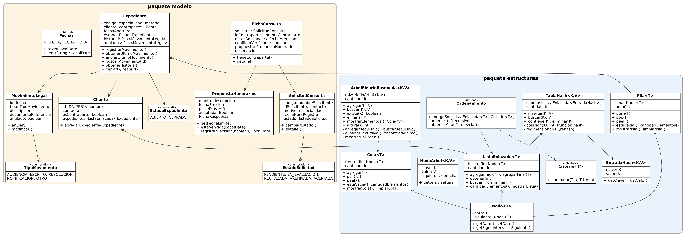
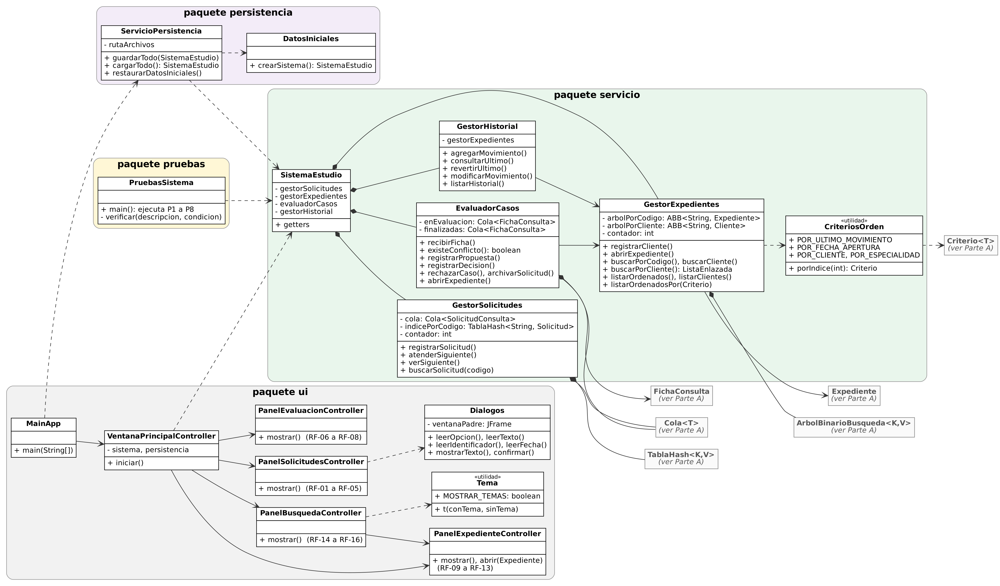
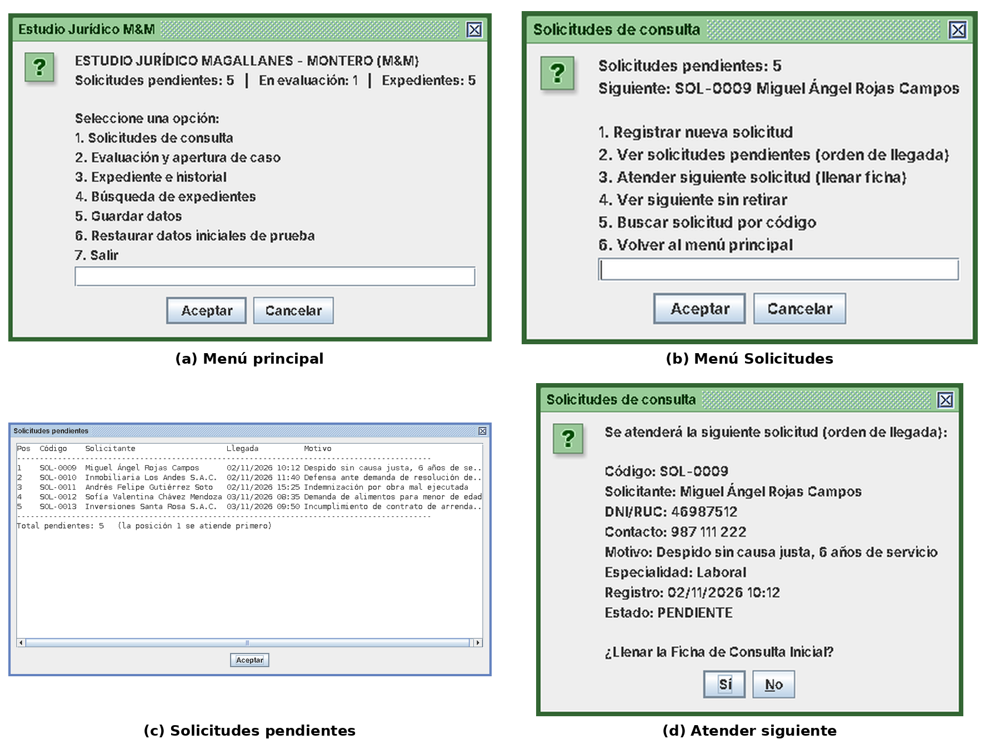
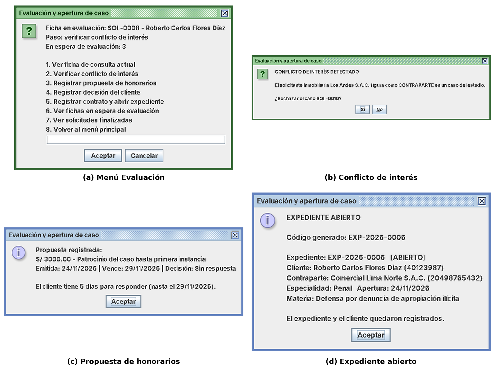
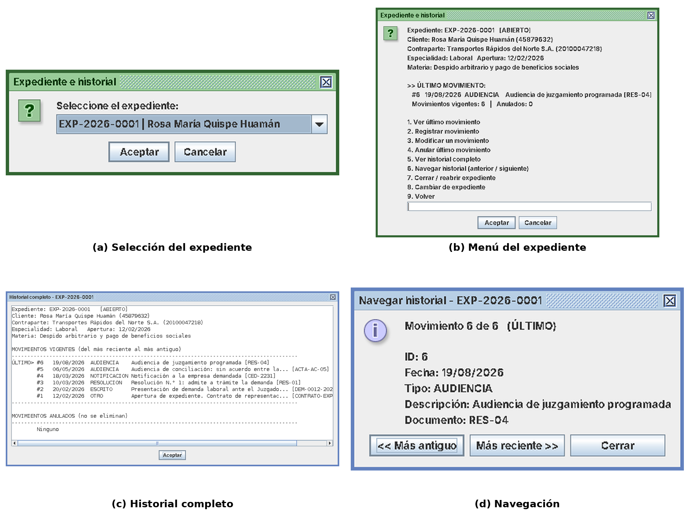
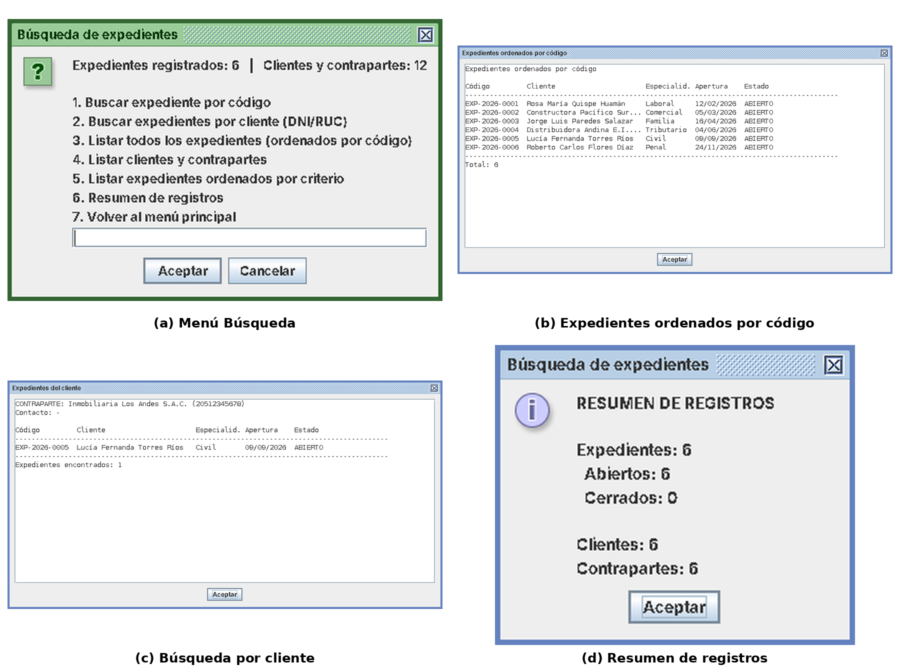
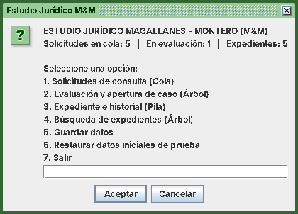
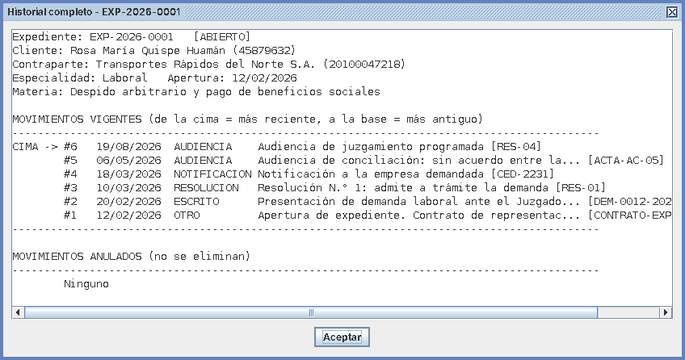
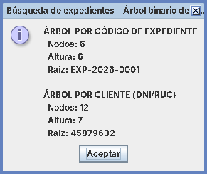

# Estudio Jurídico Magallanes - Montero (M&M)

Aplicativo de escritorio en **Java** que automatiza la recepción de consultas, la evaluación y apertura de casos y el historial de los expedientes de un estudio jurídico. Lo desarrollamos como **Proyecto Final del curso Algoritmos y Estructura de Datos** (Universidad Tecnológica del Perú, 2026).

El proyecto aplica estructuras de datos y algoritmos **implementados por el equipo, sin usar las colecciones de `java.util`**:

| Estructura | Problema del estudio que resuelve | Dónde está |
|---|---|---|
| **Cola (FIFO)** | Atender las solicitudes de los clientes en estricto orden de llegada | `estructuras/Cola.java` |
| **Pila (LIFO)** | Ver al instante el último movimiento de un expediente y anular un registro erróneo sin perderlo | `estructuras/Pila.java` |
| **Árbol binario de búsqueda** | Encontrar expedientes por código y clientes por DNI/RUC, y detectar conflictos de interés | `estructuras/ArbolBinarioBusqueda.java` |
| **Lista enlazada** | Guardar los expedientes de cada cliente; cubetas de la tabla hash | `estructuras/ListaEnlazada.java` |
| **Tabla hash** | Encontrar cualquier solicitud por su código al instante | `estructuras/TablaHash.java` |
| **Merge sort (recursivo)** | Listar expedientes por actividad reciente, fecha, cliente o especialidad | `estructuras/Ordenamiento.java` |

---

## Contenido

- [Problema y solución](#problema-y-solución)
- [Temas del curso aplicados](#temas-del-curso-aplicados)
- [Requisitos](#requisitos)
- [Cómo ejecutarlo](#cómo-ejecutarlo)
- [Uso del aplicativo](#uso-del-aplicativo)
- [Pruebas](#pruebas)
- [Arquitectura](#arquitectura)
- [Capturas](#capturas)
- [Estructura del repositorio](#estructura-del-repositorio)
- [Problemas comunes](#problemas-comunes)
- [Limitaciones y mejoras futuras](#limitaciones-y-mejoras-futuras)
- [Equipo](#equipo)

---

## Problema y solución

El estudio gestionaba su trabajo diario con hojas de cálculo y carpetas físicas, lo que causaba tres problemas:

1. **Ingreso desordenado de solicitudes.** No había un registro único ni un orden formal de atención.
2. **Búsqueda manual del último movimiento.** El abogado debía revisar todo el papeleo para encontrar la actualización más reciente del caso.
3. **Localización lenta de expedientes.** Para revisar un conflicto de interés había que buscar a mano entre clientes y contrapartes.

El aplicativo resuelve cada problema con una estructura de datos y sigue el flujo BPMN del estudio:

```
Solicitud ──► COLA ──► Ficha de consulta ──► ¿Conflicto? (ÁRBOL de clientes)
                                               │ sí → Rechazar
                                               │ no → Propuesta de honorarios (5 días)
                                               │        ├ no acepta / vence → Archivar
                                               │        └ acepta → Abrir expediente (ÁRBOL por código)
                                               ▼
                               Historial del expediente (PILA): cima = último movimiento
```

---

## Temas del curso aplicados

| Semana | Tema | Aplicación en el proyecto |
|---|---|---|
| 1 | Introducción a las estructuras de datos | Uso combinado de estructuras estáticas (arreglos) y dinámicas (nodos) |
| 2–3 | Arreglos unidimensionales | Lista de especialidades, copia del historial a un arreglo para navegarlo por índice |
| 6 | Tipo Abstracto de Datos (TAD) | Paquete `modelo`: `SolicitudConsulta`, `Cliente`, `Expediente`, `MovimientoLegal`, `PropuestaHonorarios`… |
| 7–8 | Listas enlazadas y su recorrido | `Nodo<T>` y `ListaEnlazada<T>`: expedientes de cada cliente y cubetas de la tabla hash |
| 11 | Pilas | `Pila<T>` dinámica: `push`, `pop`, `peek`, `estaVacia`, `cantidadElementos`, `mostrarPila`, `limpiarPila` |
| 12 | Colas | `Cola<T>` dinámica: `agregar`, `poll`, `peek`, `estaVacia`, `cantidadElementos`, `mostrarCola`, `limpiarCola` |
| Árbol Binario | Árbol binario de búsqueda | `ArbolBinarioBusqueda<K,V>`: `agregar`, `buscar`, `eliminar` (con `encontrarMinimo`), `mostrarElementos` (recorrido en orden) |
| Tablas hash | Función hash y encadenamiento | `TablaHash<K,V>` con rehash: búsqueda de solicitudes por código |
| Búsqueda, ordenamiento y recursividad | Merge sort, búsqueda secuencial, en árbol y en tabla hash | `Ordenamiento.mergeSort()` recursivo; métodos recursivos del árbol |
| Todas | Entorno visual con `JOptionPane` | Toda la interfaz se maneja con cuadros de diálogo |

Los métodos de la Pila, la Cola y el Árbol usan **los mismos nombres y la misma lógica que el material del curso**. Las diferencias son:

- **Son genéricas** (`<T>`, `<K,V>`), así que guardan objetos del estudio en lugar de solo `String` o `int`.
- **El árbol ordena por una clave** (código de expediente o DNI/RUC) y guarda el objeto. `buscar` devuelve el objeto encontrado, y `existe` devuelve `true` o `false`.
- **El recorrido en orden se guarda en nuestra `Cola`** en lugar de un `ArrayList`, porque el proyecto no usa `java.util`.

### Dónde se usa cada estructura

| Clase | Estructura | Para qué |
|---|---|---|
| `GestorSolicitudes` | `Cola<SolicitudConsulta>` | Solicitudes pendientes en orden de llegada |
| `EvaluadorCasos` | `Cola<FichaConsulta>` (2) | Fichas en evaluación y fichas finalizadas |
| `GestorExpedientes` | `ArbolBinarioBusqueda<String, Expediente>` | Búsqueda de expedientes por código |
| `GestorExpedientes` | `ArbolBinarioBusqueda<String, Cliente>` | Clientes y contrapartes por DNI/RUC, detección de conflictos |
| `Expediente` | `Pila<MovimientoLegal>` (2) | Movimientos vigentes (cima = último) y movimientos anulados |
| `Expediente.registrarMovimiento` | Pila auxiliar | Ubica un movimiento con fecha atrasada en su lugar cronológico |
| `Cliente` | `ListaEnlazada<Expediente>` | Expedientes en los que participa cada cliente o contraparte |
| `GestorSolicitudes` | `TablaHash<String, SolicitudConsulta>` | Índice de todas las solicitudes por código |
| `GestorExpedientes.listarOrdenadosPor` | `Ordenamiento.mergeSort` + `CriteriosOrden` | Listados ordenados por criterio |

---

## Requisitos

- **JDK 17 o superior** (el proyecto está configurado para Java 17; probado con JDK 21).
- **Apache NetBeans** (proyecto *Java with Ant*). También se puede compilar desde la terminal, sin NetBeans.
- **No necesita** librerías externas, base de datos ni conexión a internet.

---

## Cómo ejecutarlo

### Opción 1: Apache NetBeans (recomendada)

1. Descargar el repositorio: botón **Code → Download ZIP**, o con `git clone`.
2. En NetBeans: **File → Open Project…** y elegir la carpeta `EstudioJuridicoMM`.
3. Ejecutar con **F6 (Run Project)**. La clase principal es `ui.MainApp`.

### Opción 2: Terminal

Desde la carpeta `EstudioJuridicoMM`:

**Windows (PowerShell)**
```powershell
javac -encoding UTF-8 -d out (Get-ChildItem -Recurse src -Filter *.java).FullName
java -cp out ui.MainApp
```

**Linux / macOS**
```bash
javac -encoding UTF-8 -d out $(find src -name "*.java")
java -cp out ui.MainApp
```

### Versión con temas o versión limpia

En `src/ui/Tema.java`:

```java
public static final boolean MOSTRAR_TEMAS = true;   // indica Cola, Pila, Árbol, cima, recorrido en orden…
public static final boolean MOSTRAR_TEMAS = false;  // interfaz limpia, para el usuario final o la presentación
```

El repositorio viene en `true`. El resto del código es el mismo en las dos versiones.

---

## Uso del aplicativo

La primera vez que se ejecuta, carga **datos de prueba**:

- 5 expedientes con su historial.
- 10 clientes y contrapartes.
- 1 ficha en evaluación.
- 5 solicitudes en cola.

Al salir, todo se guarda en `datos_estudio_mm.dat`. Para volver a los datos de prueba: **menú principal → opción 6**.

| Módulo | Qué hace | Requerimientos |
|---|---|---|
| 1. Solicitudes de consulta | Registrar solicitudes, ver la cola, atender la siguiente, llenar la ficha y buscar una solicitud por código | RF-01 a RF-05, RF-18 |
| 2. Evaluación y apertura | Verificar conflicto de interés, propuesta de honorarios (plazo de 5 días), decisión del cliente, abrir expediente | RF-06 a RF-08 |
| 3. Expediente e historial | Ver el último movimiento, registrar, modificar, anular, ver el historial completo y navegarlo | RF-09 a RF-13 |
| 4. Búsqueda de expedientes | Buscar por código o por DNI/RUC, listar ordenado, listar por criterio (merge sort), ver datos de los árboles | RF-14 a RF-16, RF-19 |
| Guardar / salir | Persistencia en archivo local | RF-17 |

### Casos para probar

- **Conflicto de interés (el solicitante es contraparte):** atender la solicitud `SOL-0010` (Inmobiliaria Los Andes, RUC `20512345678`). Es contraparte en `EXP-2026-0005`.
- **Conflicto de interés (la contraparte es cliente):** en `SOL-0011`, ingresar como contraparte el RUC `20601234567` (Constructora Pacífico Sur), que es cliente del estudio.
- **Plazo vencido:** registrar una propuesta con fecha antigua y una respuesta 6 o más días después. La solicitud se **archiva**.
- **Movimiento intermedio:** en `EXP-2026-0001`, registrar un movimiento con fecha `01/04/2026`. Se ubica en su lugar con una pila auxiliar, y la cima sigue siendo el más reciente.
- **Movimiento anulado:** `EXP-2026-0002` tiene un movimiento anulado que se conserva en la pila de anulados.

---

## Pruebas

La clase `pruebas/PruebasSistema.java` (ejecutar con **Shift + F6**) verifica 29 condiciones en 8 casos y muestra `[PASO]` o `[FALLO]` por cada una:

| Caso | Qué verifica |
|---|---|
| P1 | Orden de atención: la cola atiende en el mismo orden de registro (FIFO) |
| P2 | Historial: la cima es siempre el último movimiento; anular no borra datos |
| P3 | Integridad al guardar y cargar el archivo (cola, historiales, árboles) |
| P4 | Restaurar datos iniciales y recargar el archivo |
| P5 | Árbol binario: agregar, buscar, recorrido en orden y eliminar con dos hijos |
| P6 | Tabla hash: búsqueda por código y 500 claves con rehash |
| P7 | Lista enlazada y merge sort |
| P8 | Detección de conflicto de interés |

Usa archivos temporales, así que no modifica los datos guardados del usuario.

---

## Arquitectura

Arquitectura por capas, organizada en paquetes:

```
EstudioJuridicoMM/src
├── estructuras/    Cola, Pila, Nodo, ListaEnlazada, TablaHash, EntradaHash,
│                   ArbolBinarioBusqueda, NodoArbol, Criterio, Ordenamiento (implementación propia)
├── modelo/         SolicitudConsulta, FichaConsulta, PropuestaHonorarios, Cliente,
│                   Expediente, MovimientoLegal, Fechas y enums de estados y tipos
├── servicio/       GestorSolicitudes, EvaluadorCasos, GestorExpedientes,
│                   GestorHistorial, SistemaEstudio, CriteriosOrden (reglas del negocio / BPMN)
├── persistencia/   ServicioPersistencia (guardar y cargar), DatosIniciales (datos de prueba)
├── ui/             MainApp, VentanaPrincipalController, Panel*Controller,
│                   Dialogos (JOptionPane) y Tema (versión con temas o limpia)
└── pruebas/        PruebasSistema (pruebas P1 a P8)
```

Cada capa usa solo a la de abajo: `ui` → `servicio` → `modelo` → `estructuras`. Así, cambiar una estructura (por ejemplo, el árbol) no afecta a la interfaz.

### Diagrama de clases

**Parte A: paquetes `estructuras` y `modelo`**



**Parte B: paquetes `servicio`, `persistencia` y `ui`**



---

## Capturas

Las capturas de los módulos corresponden a la versión limpia (`MOSTRAR_TEMAS = false`).

| Solicitudes (Cola) | Evaluación y apertura (Árbol) |
|---|---|
|  |  |

| Expediente e historial (Pila) | Búsqueda (Árbol) |
|---|---|
|  |  |

**Versión con temas** (`MOSTRAR_TEMAS = true`):

| Menú principal | Expediente (cima de la pila) | Datos de los árboles |
|---|---|---|
|  |  |  |

---

## Estructura del repositorio

```
├── EstudioJuridicoMM/                              Proyecto de Apache NetBeans (código fuente en src/)
├── Informe_Final_Proyecto_Estudio_Juridico_MM.docx Informe final (capítulos 1 a 5 y anexos, formato APA)
├── diagrama_clases_parteA.png / parteB.png         Diagrama de clases
├── modulo_*.png, con_temas_*.png, limpio_*.png     Capturas del aplicativo
├── .gitignore
└── README.md
```

---

## Problemas comunes

| Situación | Solución |
|---|---|
| Aviso `location of system modules is not set in conjunction with -source 17` | **No es un error.** El proyecto está configurado en Java 17 y el JDK instalado es más nuevo. Para quitarlo: clic derecho al proyecto → Properties → Sources → *Source/Binary Format* = versión del JDK → Clean and Build. |
| "No pasa nada" al ejecutar | Ejecutar con **F6** (Run Project), no con Shift+F6 sobre otra clase. El menú aparece en la barra de tareas como *Estudio Jurídico M&M*. |
| Los menús tapan otras ventanas | Es intencional, para que no queden escondidos detrás de NetBeans. Para desactivarlo: en `ui/Dialogos.java`, `SIEMPRE_ADELANTE = false`. |
| Quiero volver a los datos iniciales | Menú principal → opción 6, o borrar el archivo `datos_estudio_mm.dat`. |

---

## Limitaciones y mejoras futuras

- **Árbol desbalanceado.** Los códigos de expediente se generan en orden, así que el árbol por código tiende a quedar inclinado hacia un lado (altura = número de expedientes). Como mejora se propone un **árbol AVL**.
- **Uso local.** Es un solo usuario, sin inicio de sesión ni acceso desde otras computadoras.
- **Landing Page simulada.** El ingreso de solicitudes desde la web se simula con datos de prueba.
- **Fuera del alcance:** facturación, cobranzas, dashboard y los demás procesos del mapa.

---

## Equipo

**Universidad Tecnológica del Perú, Facultad de Ingeniería**
Curso: Algoritmos y Estructura de Datos · Sección 34674 · Lima, 2026
Profesor: Henry Hermes Alcantara Valderrama

Integrantes:

- Alexandra del Carmen Magallanes Saldaña (coordinadora y desarrolladora principal)
- Celso Eduardo Machuca García
- Carlo Cesar Montañez Millones
- Fabrizio Ángel Puente Rodriguez
- Jhonfranklin Diaz Diaz
